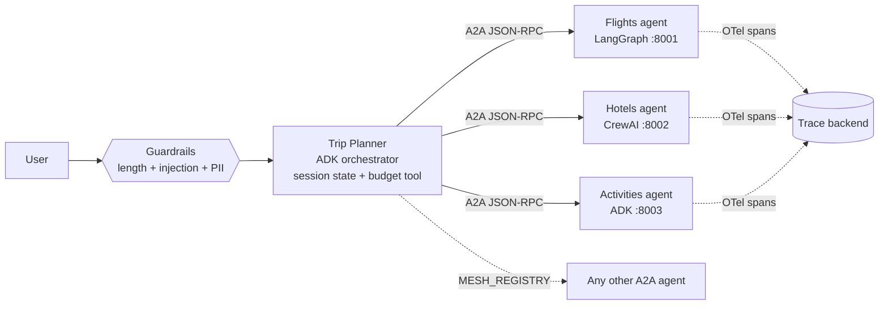

# A2A Agent Mesh

A **Google ADK** orchestrator that plans trips by delegating, over the open **A2A (Agent2Agent) protocol**, to specialist agents built in *different frameworks*: LangGraph, CrewAI and ADK itself.



| Agent | Framework | Port | Skill |
|---|---|---|---|
| `trip_planner` | Google ADK | 8000 (dev UI) | Collects the brief, delegates, checks budget, merges one itinerary |
| `flights_agent` | LangGraph | 8001 | Search & compare flights |
| `hotels_agent` | CrewAI | 8002 | Find best-value hotels |
| `activities_agent` | Google ADK (`to_a2a`) | 8003 | Suggest things to do |

See [docs/architecture.md](docs/architecture.md) for the request sequence and design decisions.

## What it demonstrates
- **Cross-framework interop** - one framework-agnostic `AgentExecutor` wraps LangGraph and CrewAI as A2A servers (a2a-sdk 1.x); ADK agents use `to_a2a` / `RemoteA2aAgent`.
- **Pluggable agents** - add or replace specialists with a JSON registry (`MESH_REGISTRY`, see `registry.example.json`), no code changes.
- **Guardrails** - `before_model_callback`s cap input length, block prompt injection and mask card numbers, emails and phones before anything reaches Gemini.
- **Session state** - the trip brief lives in ADK state (`{trip?}` in the instruction), and budget maths is a deterministic tool, not LLM arithmetic.
- **Cost tracking** - an `after_model_callback` records calls, tokens and estimated USD cost per session.
- **Resilient specialists** - failures come back as readable replies (the planner works around the gap), identical queries hit a TTL cache, a semaphore caps concurrent LLM calls, and `/healthz` gates compose start-up.
- **Distributed tracing** - the orchestrator forwards `traceparent` on every A2A call and each specialist continues the trace (cache hits and errors are tagged on the span); export via OTLP.
- **Reproducible data** - flights and hotels come from a seeded mock inventory, so demos and evals give the same options every run.
- **Persistent sessions** - `make web` and compose store ADK sessions in SQLite, so trip briefs and usage survive restarts.
- **Evals** - `adk eval` set; an LLM-as-judge over 6 scenarios with repeated runs (mean and stdev) plus a deterministic delegation-coverage metric; 40 offline tests in CI.
- **Deployable** - one Docker image, `docker compose` locally, `deploy/cloudrun.sh` for Cloud Run.

## Quickstart
```bash
cp .env.example .env              # add your Gemini API key
pip install -e ".[dev,tracing]"
python scripts/run_agents.py      # starts the 3 A2A servers (any OS)
adk web --session_service_uri sqlite+aiosqlite:///./sessions.db mesh   # or: make web
```

Poke a single agent with raw A2A JSON-RPC:
```bash
python scripts/a2a_ping.py http://localhost:8001 "Flights from Mumbai to Goa on 2026-12-20"
```

Check every agent card is reachable:
```bash
python scripts/check_mesh.py      # exits non-zero if any agent is down
```

Dev setup: `pre-commit install` runs ruff lint and format on every commit.

Run everything in containers:
```bash
docker compose up --build         # dev UI on http://localhost:8000
```

Deploy to Cloud Run (Gemini key in Secret Manager as `gemini-api-key`):
```bash
PROJECT=my-project REGION=asia-south1 bash deploy/cloudrun.sh
```

## Tests and evals
```bash
pytest -q                         # 40 offline tests: protocol, resilience, guardrails, tools, evals
make eval                         # adk eval (needs API key + agents running)
python eval/judge.py --runs 3     # LLM-as-judge -> eval/results.md (needs API key + agents)
```

Tracing: set `OTEL_EXPORTER_OTLP_ENDPOINT` (e.g. a local Jaeger at `http://localhost:4318`) or `MESH_TRACE_CONSOLE=1`.

## Roadmap
- [x] Guardrail callbacks (length, prompt injection, PII)
- [x] Distributed tracing across A2A hops
- [x] `adk eval` set, LLM-as-judge scorer, offline tests
- [x] Docker compose and Cloud Run deploy script
- [x] Pluggable agent registry and per-session cost tracking
- [x] Graceful failures, response cache, concurrency limit, health checks
- [x] Persistent SQLite sessions; judge with repeated runs and delegation coverage
- [ ] Publish judge scores from a live run
- [ ] Real flight / hotel APIs instead of mock data
- [ ] Streaming responses across A2A
- [ ] Auth between services (ID tokens) for private Cloud Run
