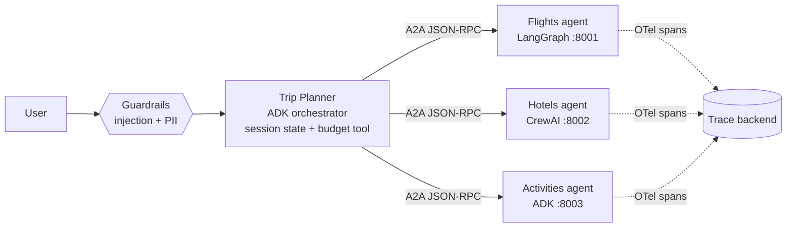

# A2A Agent Mesh

A **Google ADK** orchestrator that plans trips by delegating, over the open **A2A (Agent2Agent) protocol**, to specialist agents built in *different frameworks*: LangGraph, CrewAI and ADK itself.



| Agent | Framework | Port | Skill |
|---|---|---|---|
| `trip_planner` | Google ADK | 8000 (dev UI) | Collects the brief, delegates, checks budget, merges one itinerary |
| `flights_agent` | LangGraph | 8001 | Search & compare flights |
| `hotels_agent` | CrewAI | 8002 | Find best-value hotels |
| `activities_agent` | Google ADK (`to_a2a`) | 8003 | Suggest things to do |

## What it demonstrates
- **Cross-framework interop** - one framework-agnostic `AgentExecutor` wraps LangGraph and CrewAI as A2A servers; ADK agents use `to_a2a` / `RemoteA2aAgent`.
- **Guardrails** - `before_model_callback`s block prompt injection and mask card numbers, emails and phones before anything reaches Gemini.
- **Session state** - the trip brief lives in ADK state (`{trip?}` in the instruction), and budget maths is a deterministic tool, not LLM arithmetic.
- **Observability** - every A2A hop is an OpenTelemetry span (latency, payload size) that continues the caller's `traceparent`; export via OTLP.
- **Evals** - `adk eval` set for tool trajectory and response match, plus offline unit tests in CI.
- **Deployable** - one Docker image, four services via `docker compose`; agent URLs are env-configurable for Cloud Run.

## Quickstart
```bash
cp .env.example .env              # add your Gemini API key
pip install -e ".[dev,tracing]"
python scripts/run_agents.py      # starts the 3 A2A servers (any OS)
adk web mesh                      # ADK dev UI -> pick "orchestrator"
```

Poke a single agent with raw A2A JSON-RPC:
```bash
python scripts/a2a_ping.py http://localhost:8001 "Flights from Mumbai to Goa on 2026-12-20"
```

Run everything in containers:
```bash
docker compose up --build         # dev UI on http://localhost:8000
```

## Tests and evals
```bash
pytest -q                         # offline: guardrails, tools, wiring
make eval                         # adk eval against eval/trip_planner.evalset.json (needs API key + agents running)
```

Tracing: set `OTEL_EXPORTER_OTLP_ENDPOINT` (e.g. a local Jaeger at `http://localhost:4318`) or `MESH_TRACE_CONSOLE=1`.

## Roadmap
- [x] Guardrail callbacks (prompt injection, PII)
- [x] OpenTelemetry spans per A2A hop
- [x] `adk eval` set + offline tests
- [x] Docker compose for the full mesh
- [ ] LLM-as-judge itinerary-quality scores, published as a results table
- [ ] Real flight / hotel APIs instead of mock data
- [ ] Streaming responses across A2A
- [ ] Deploy to Cloud Run / Vertex AI Agent Engine
