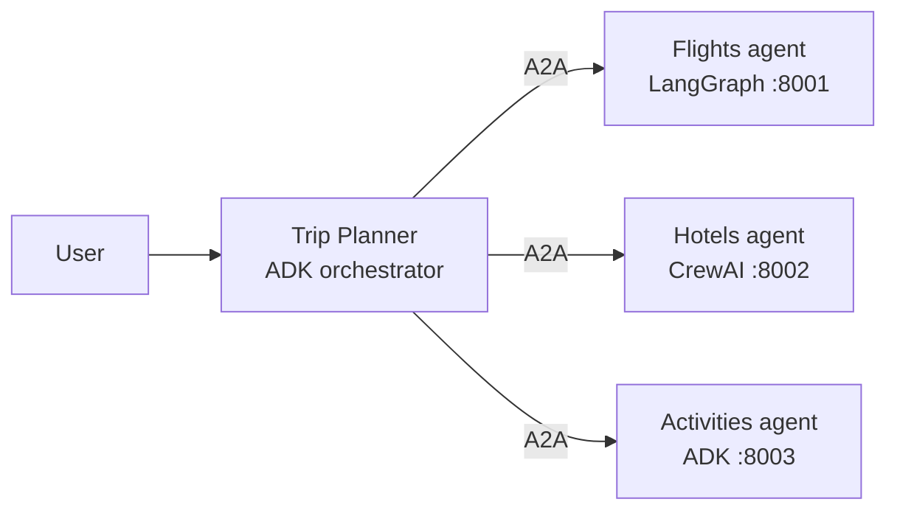

# A2A Agent Mesh

A **Google ADK** orchestrator that plans trips by delegating, over the open **A2A (Agent2Agent) protocol**, to specialist agents built in *different frameworks*: LangGraph, CrewAI and ADK itself.



| Agent | Framework | Port | Skill |
|---|---|---|---|
| `trip_planner` | Google ADK | – | Orchestrates, merges a single itinerary |
| `flights_agent` | LangGraph | 8001 | Search & compare flights |
| `hotels_agent` | CrewAI | 8002 | Find best-value hotels |
| `activities_agent` | Google ADK (`to_a2a`) | 8003 | Suggest things to do |

## Quickstart
```bash
cp .env.example .env   # add your Gemini API key
make install
make agents            # starts the 3 A2A servers
make web               # ADK dev UI -> pick "orchestrator"
```

## Roadmap
- [ ] Evals (`adk eval`) with itinerary-quality metrics
- [ ] OpenTelemetry tracing across A2A hops
- [ ] Guardrail callbacks (budget limits, PII)
- [ ] Deploy to Cloud Run / Vertex AI Agent Engine
