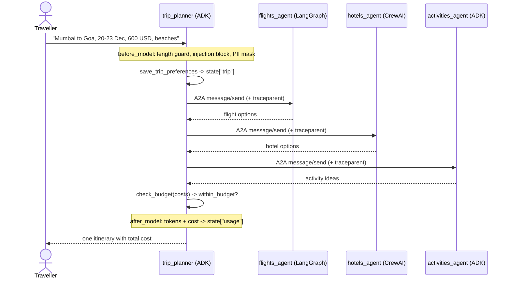

# Architecture

## Request flow

## Design decisions

| Decision | Why |
|---|---|
| A2A between agents, not in-process calls | Each specialist can use the framework that suits it, scale independently and be swapped for a third-party agent. |
| One `FnExecutor` for non-ADK agents | LangGraph and CrewAI only need an `async (text) -> text` handler; the wrapper owns the A2A protocol, cards and tracing. |
| Registry file (`MESH_REGISTRY`) | New or partner agents join the mesh by config, and their descriptions drive delegation. |
| Budget maths in a tool | LLM arithmetic drifts; `check_budget` is exact and testable. |
| Guardrails as `before_model_callback`s | They run on every model call, cost nothing when they pass, and short-circuit without an LLM call when they fire. |
| Trace context over HTTP headers | One trace spans orchestrator and specialists, so slow hops are visible per agent. |

## Measuring quality

- `pytest` - offline: protocol round trip, guardrails, tools, registry, usage tracking.
- `adk eval` - trajectory and response checks (`eval/trip_planner.evalset.json`).
- `eval/judge.py` - LLM-as-judge on 6 scenarios, scoring completeness, budget adherence, coherence and grounding (1-5), written to `eval/results.md`.
